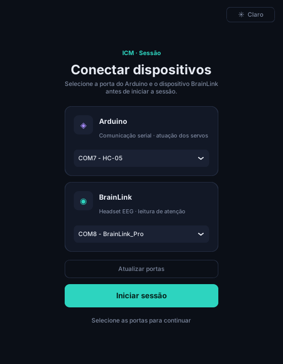
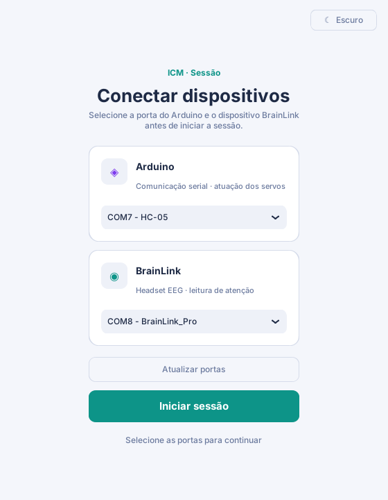
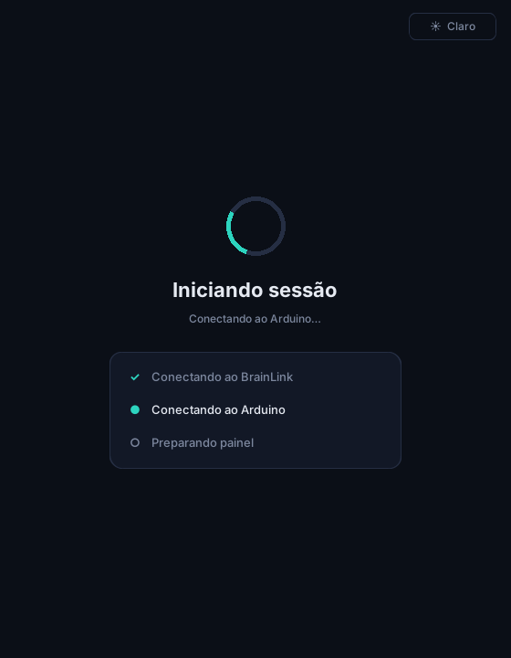
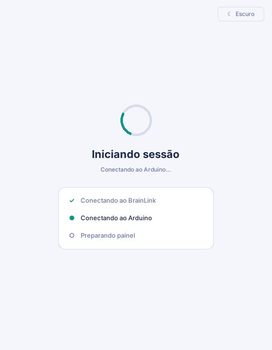
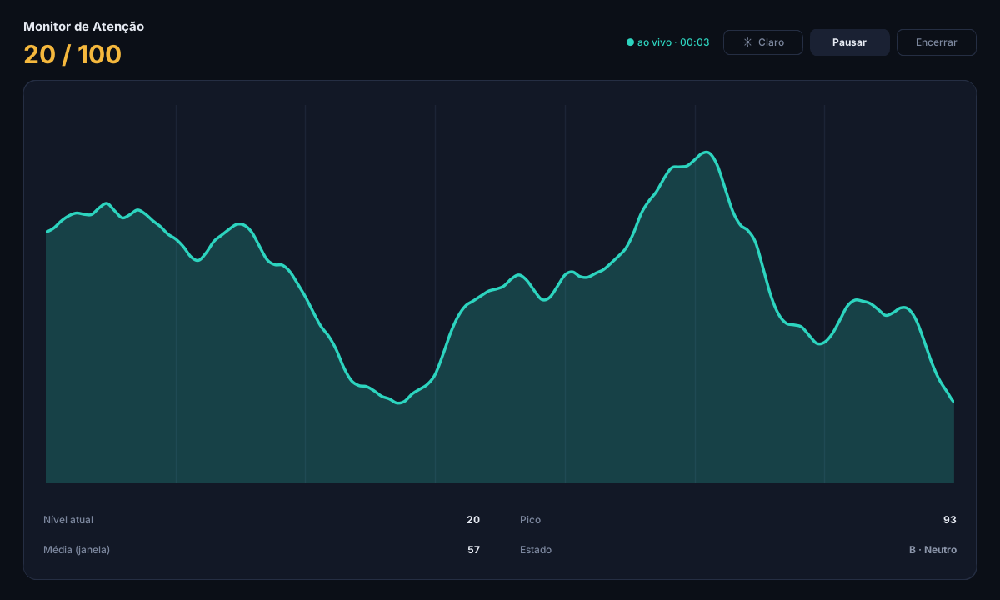
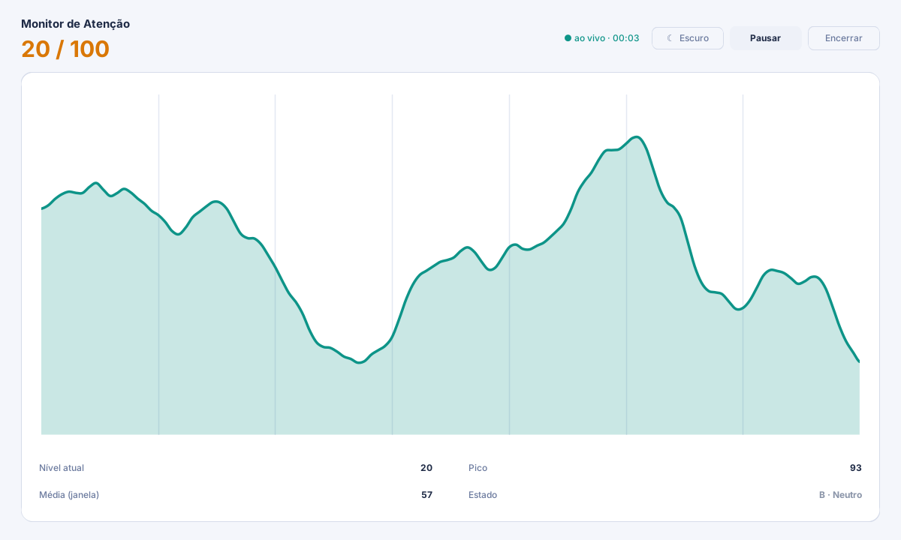

# Interface Cérebro-Máquina de baixo custo

Interface cérebro-máquina (ICM) de baixo custo que controla uma mão robótica a partir do
**índice de atenção** do headset EEG **BrainLink** (Macrotellect).

Como funciona:

1. O BrainLink envia os pacotes EEG via Bluetooth (porta serial, 57600 bps).
2. O SDK `BrainLinkParser` decodifica o índice de atenção (0–100).
3. A atenção passa por um **filtro EMA** (média móvel exponencial) com **alpha = 0,50**.
4. Uma **máquina de estados com trava** converte a atenção filtrada em um dos estados **A–E**.
   Depois de um foco alto (D ou E), uma queda de atenção leva ao estado neutro **B** e trava
   o sistema, evitando que a mão passe direto para o estado de distração.
5. O estado (um caractere `A`–`E`) é enviado ao **Arduino** pelo módulo Bluetooth **HC-05**
   (9600 bps), que posiciona os cinco servos dos dedos.
6. Uma interface gráfica (CustomTkinter + Matplotlib) mostra a atenção filtrada, o histórico e o
   estado atual em tempo real, com tema claro ou escuro.

| Estado | Significado  |
|--------|--------------|
| A      | Distração    |
| B      | Neutro       |
| C      | Foco leve    |
| D      | Foco alto    |
| E      | Foco máximo  |

## Requisitos

- **Windows** (o SDK do BrainLink é distribuído como `.pyd` para Windows)
- **Python 3.11** (o SDK é compilado para o CPython 3.11)
- Headset BrainLink pareado via Bluetooth
- Arduino com 5 servos e módulo HC-05

## Instalação

```bash
pip install -r requirements.txt
```

O SDK do BrainLink **não** está no repositório (é da Macrotellect e não tem licença de
redistribuição). Baixe `BrainLinkParser.pyd` de
<https://github.com/Macrotellect/BrainLinkParser-Python> e coloque em:

```
deps/BrainLinkParser.pyd
```

Para conferir se está tudo no lugar, rode da raiz do projeto:

```bash
python -m tests.teste_rapido
```

O teste deve terminar com `RESULTADO: TUDO OK`.

## Execução

```bash
python main.py
```

Na tela inicial, escolha a porta serial do Arduino (HC-05) e a do BrainLink e clique em
**Iniciar sessão**. Veja abaixo como funciona cada tela.

## Interface

A interface tem três telas. Todas têm um botão no canto superior direito para alternar entre
o tema **claro** e o **escuro**; a escolha fica salva em `~/.icm_tema` e é usada da próxima vez
que o programa abrir.

### 1. Conectar dispositivos

Escolha a porta serial do Arduino e a do BrainLink. O programa já pré-seleciona o **HC-05** para o
Arduino e o **BrainLink** para o headset, se eles estiverem pareados. Se conectou um aparelho
depois de abrir o programa, clique em **Atualizar portas**.

| Escuro | Claro |
|--------|-------|
|  |  |

### 2. Iniciando sessão

Enquanto o programa conecta ao BrainLink e ao Arduino, esta tela mostra cada etapa. A conexão
roda em segundo plano, então a janela não trava. Se alguma conexão falhar, a etapa fica vermelha
com a mensagem de erro e o programa volta para a tela anterior, mantendo as portas escolhidas.

| Escuro | Claro |
|--------|-------|
|  |  |

### 3. Monitor de Atenção

Mostra a atenção filtrada em tempo real (`X / 100`) e o histórico das últimas 120 leituras num
gráfico que desliza de forma contínua, a 60 fps. Embaixo do gráfico ficam o nível atual, o pico,
a média da janela e o estado atual (A–E). No topo ficam o tempo de sessão e os botões:

- **Pausar / Retomar**: congela o gráfico e os valores na tela (a mão robótica continua recebendo os estados)
- **Encerrar**: fecha o programa

| Escuro | Claro |
|--------|-------|
|  |  |

> As capturas foram feitas com dados simulados.

## Gerar o executável (.exe)

Dá para transformar o programa num executável que abre com dois cliques, sem precisar ter o
Python instalado no computador onde ele vai rodar. O executável precisa ser gerado **no Windows**,
com o mesmo Python 3.11 do projeto e o SDK do BrainLink em `deps/BrainLinkParser.pyd`.

1. Instale o PyInstaller (uma vez só):

   ```bash
   pip install -r requirements.txt pyinstaller
   ```

2. Gere o executável, na raiz do projeto:

   ```bash
   python build_exe.py
   ```

   O resultado fica em `dist/ICM-Monitor/`. Abra `ICM-Monitor.exe`. Para levar para outro
   computador, copie a **pasta inteira** `dist/ICM-Monitor/`, porque o `.exe` usa os arquivos
   que estão ao lado dele.

Se preferir um **único arquivo** `dist/ICM-Monitor.exe`, mais fácil de copiar:

```bash
python build_exe.py --um-arquivo
```

Ele demora alguns segundos a mais para abrir, porque se descompacta a cada execução.

> O executável inclui o SDK do BrainLink, que não tem licença de redistribuição. Use-o nos seus
> próprios computadores e não publique o `.exe` (por exemplo, numa *release* do GitHub).

Se o Windows Defender ou o SmartScreen avisar que o programa é desconhecido, é normal para
executáveis feitos com PyInstaller que não são assinados digitalmente. Clique em
**Mais informações → Executar assim mesmo**.

## Firmware

O código do Arduino está em `firmware/icm_firmware.ino`.

- Servos nos pinos **3, 5, 6, 9 e 10** (polegar, indicador, médio, anelar e mínimo)
- Comunicação serial a **9600 bps**: recebe um caractere `A`–`E` e move os dedos
- **Desconecte o HC-05 dos pinos 0 (RX) e 1 (TX) antes de gravar** o firmware; senão o upload falha

## Estrutura de pastas

```
.
├── main.py                       # ponto de entrada
├── build_exe.py                  # gera o executável (.exe) com o PyInstaller
├── requirements.txt
├── assets/
│   └── icone.ico                 # ícone do programa e da janela
├── core/
│   └── state_enum.py             # enum State (A–E) com comparação de ordem
├── deps/
│   └── BrainLinkParser.pyd       # SDK do BrainLink (baixar manualmente, não versionado)
├── docs/
│   └── img/                      # capturas das telas usadas neste README
├── firmware/
│   └── icm_firmware.ino          # firmware do Arduino (servos)
├── src/
│   ├── adapters/                 # conexão serial com Arduino e BrainLink
│   ├── models/
│   │   └── eeg_buffer.py         # buffer thread-safe lido pela interface
│   ├── services/
│   │   ├── eeg_state_machine.py  # filtro EMA + máquina de estados
│   │   └── eeg_state_sytem.py    # orquestra hardware, máquina de estados e UI
│   ├── ui/
│   │   └── app.py                # interface gráfica (CustomTkinter)
│   └── utils/
└── tests/
    └── teste_rapido.py           # teste de imports e da máquina de estados
```
