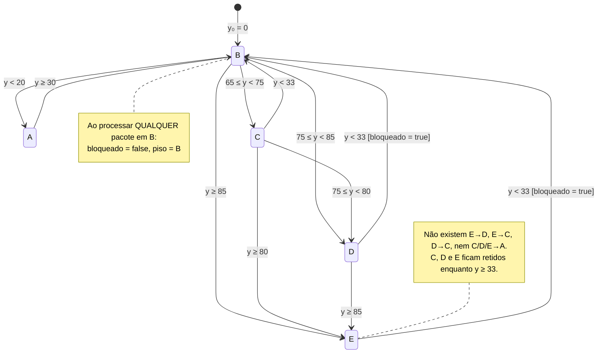

# Ensaios de bancada – Interface Cérebro-Máquina (sem participantes humanos)

Tudo nesta pasta é novo. O código original **não foi alterado**. A única exceção é a linha
pedida no firmware (`case 'T'`, Parte 2), que só responde a um caractere que o software nunca envia.
Números que dependem de hardware estão marcados como **a medir**.

| Arquivo | Conteúdo |
|---|---|
| `logica_icm.py` | Lógica isolada: importa `EEGStateMachine` sem modificação + lógicas de comparação |
| `ensaio1_sintetico.py` | Parte 1 – sinal sintético (roda sem hardware) |
| `ensaio2_latencia.py` | Parte 2 – latência PC ↔ HC-05 ↔ Arduino (**a medir**) |
| `ensaio3_4_headset.py` | Parte 3 – qualidade de sinal e taxa de atualização do BrainLink (**a medir**) |
| `resultados/` | CSV, tabelas Markdown e figuras do ensaio 1 |

### De onde veio cada trecho de lógica usado nos ensaios

| Trecho nos ensaios | Origem no repositório | Como |
|---|---|---|
| `MaquinaReal` | `src/services/eeg_state_machine.py` (classe inteira, linhas 3-67) | **importada**, sem cópia |
| `pacote_para_comando` | `src/services/eeg_state_sytem.py`, `_on_eeg`, linhas 20-28 | reproduzida (3 linhas: descarta `attention == 0`, chama `processar`, envia) |
| `ema` | `eeg_state_machine.py`, linha 13 (`_filtro_passa_baixa`) | reproduzida; só é usada nas lógicas de comparação |
| `MaquinaRealSemBloqueado` | `eeg_state_machine.py`, linhas 16-60 | cópia literal **sem** as linhas de `bloqueado` (8, 24, 54, 59), para provar que essa variável não tem efeito |
| `FaixasSemTrava`, `HistereseClassica` | — | **não existem no projeto**: são referências de comparação |
| Leitura do headset (ensaio 3) | `src/adapters/brainlink_adapter.py` + `eeg_state_sytem.py`, linhas 45-54 | `BrainlinkAdapter` e `BrainLinkParser` **importados**; o callback de leitura é reproduzido |
| Porta do HC-05 (ensaio 2) | `src/adapters/arduino_adapter.py`, linha 12 | mesmos parâmetros (9600 bps) |

---

## Parte 0 – Lógica real (lida do código)

### 1. Valor de α e valor inicial de y

- **α = 0,50.** É o padrão do construtor (`eeg_state_machine.py:4`, `def __init__(self, alpha=0.50)`).
  `EEGSystem` instancia sem argumento (`eeg_state_sytem.py:15`, `EEGStateMachine()`).
- **y inicial = 0** (`eeg_state_machine.py:6`, `self.att_filtrado = 0`).
- Fórmula (`eeg_state_machine.py:13`): `y ← α·x + (1−α)·y_anterior`, aplicada uma vez por pacote
  com atenção ≠ 0.
- Consequência medida: como y parte de 0, o primeiro valor filtrado é α·x. Com α = 0,5 e x ≥ 40,
  isso dá y ≥ 20, e o gesto A não aparece. Com α ≤ 0,3, a mão **passa por A ao ligar**
  (`resultados/ensaio1_partida.md`). Exemplo: com α = 0,1 e atenção constante em 42, são 11 s em A.

### 2. Envio a cada pacote ou só na mudança?

**A cada pacote.** `_on_eeg` (`eeg_state_sytem.py:19-30`) chama `self.arduino.enviar_estado(novo_estado.value)`
sempre que `data.attention != 0`. Não há comparação com o estado anterior. A taxa de comandos é,
portanto, igual à taxa de pacotes de atenção não nulos (≈ 60 comandos/min a 1 Hz). No firmware,
repetir o mesmo caractere reescreve os mesmos ângulos (`Servo.write` com o valor atual), sem movimento.

### 3. Qualidade de sinal (signal/poorSignal)

**Não é usada.** O único campo lido do objeto do SDK é `data.attention` (`eeg_state_sytem.py:20` e `:23`).
O SDK expõe o atributo `signal` em `BrainLinkData` (README de
`github.com/Macrotellect/BrainLinkParser-Python`), mas o README não documenta a faixa nem o
significado desse campo. O único "portão" existente é `if data.attention == 0: return`
(`eeg_state_sytem.py:20-21`): o pacote é descartado (não atualiza o filtro nem envia comando).
O ensaio 3 registra o `signal` e a atenção juntos. Assim dá para verificar se a atenção vale 0 quando o
headset está fora da cabeça (**a medir**).

Observação lateral: o projeto abre o BrainLink a 57600 bps (`brainlink_adapter.py:11`). O exemplo do
README do SDK usa 115200. Em portas Bluetooth SPP a velocidade costuma ser ignorada, mas vale citar no artigo.

### 4. Como funciona a "trava"

A lógica **não é um classificador por faixas**. É uma máquina de estados (`_transicao`,
`eeg_state_machine.py:16-60`). O limiar depende do estado atual, e cada pacote avalia só o
`case` do estado corrente (no máximo 1 transição por pacote).

**Pseudocódigo fiel** (y = atenção filtrada; estado inicial B; `piso` inicial B; `bloqueado` inicial falso):

```
a cada pacote x:
    se x == 0: ignorar pacote                         # eeg_state_sytem.py:20
    y ← 0,5·x + 0,5·y                                 # linha 13
    conforme estado:
      A: se y ≥ 30 → B                                # linhas 18-20
      B: piso ← B; bloqueado ← falso                  # linhas 23-24 (executa em TODO pacote em B)
         se y < 20 → A
         senão se y ≥ 85 → E (piso ← E)
         senão se y ≥ 75 → D (piso ← D)
         senão se y ≥ 65 → C (piso ← C)
      C: se y ≥ 80 → E (piso ← E)                     # atenção: 80, não 85
         senão se y ≥ 75 → D (piso ← D)
         senão se y < 33 → B                          # sem bloqueado
      D: se y ≥ 85 → E (piso ← E)
         senão se y < 33 e piso ≤ D → B; bloqueado ← verdadeiro
      E: se y < 33 e piso ≤ E → B; bloqueado ← verdadeiro
    enviar caractere do estado ao Arduino             # eeg_state_sytem.py:28
```



O que o código realmente faz:

- **A variável `bloqueado` não participa de nenhuma decisão.** Ela vira verdadeira na transição
  D→B ou E→B (linhas 54 e 59) e volta a falso no pacote seguinte, porque todo pacote processado em B
  executa `self.bloqueado = False` (linha 24) antes de testar os limiares. Ela só aparece no console
  (`eeg_state_sytem.py:36`) e na interface (`src/ui/app.py:737`, sufixo "· bloqueado" por ~1 pacote).
  Isso foi verificado numericamente: a lógica real e a cópia sem nenhuma linha de `bloqueado` deram
  **0 diferenças em 93 000 pacotes** (todos os cenários do ensaio 1, todos os α).
- **`piso` também não tem efeito.** Só se entra em D vindo de B ou C, e as duas transições fazem
  `piso ← D`. Só se entra em E fazendo `piso ← E`. Logo, `piso ≤ D` em D e `piso ≤ E` em E são sempre
  verdadeiros.
- **O que de fato funciona como "trava" é a histerese assimétrica.** C, D e E só saem para B, e só
  quando y < 33. Depois de entrar em C (y ≥ 65), a mão não volta a B enquanto y ≥ 33, e não desce de
  E para D nem de D para C. A saída é sempre para B, e B→A exige outro pacote com y < 20.
- **A "trava" vale para a faixa "até 20"?** Não. A transição A→B não mexe em `bloqueado`, e nada impede
  E→B→A em pacotes consecutivos. Exemplo medido com sinal bruto: x = 90, 90, …, 10, 10 gera
  `E, B, A` (A no 2º pacote após a queda). Com α = 0,5: `E, E, B, A`. O A tem histerese própria:
  entra com y < 20 e sai com y ≥ 30.
- **Subida contínua 50→90 (gestos D e E alcançáveis?)** E sempre é alcançado. D só é alcançado se
  algum pacote cair com y em [75, 80) enquanto o estado é C, porque de C o código vai direto para E
  com y ≥ 80, e não com 85. Resultado (`resultados/ensaio1_subida_50_90.md`, sem ruído):

  | Velocidade da subida | Bruto | α = 0,5 (código) |
  |---|---|---|
  | degrau 50→90 | B→E (**D pulado**, C também) | B→C→D→E |
  | 10 pontos/s | B→C→E (**D pulado**) | B→C→E (**D pulado**) |
  | ≤ 5 pontos/s | B→C→D→E | B→C→D→E |

  Na descida, C e D **nunca** são emitidos: E fica retido até y < 33 e então vai para B.

### 5. Limiares e mapeamento

| Transição | Limiar (sobre y filtrado) | Linha |
|---|---|---|
| B → A | y < 20 | 25 |
| A → B | y ≥ 30 | 19 |
| B → C | 65 ≤ y < 75 | 33 |
| B → D | 75 ≤ y < 85 | 30 |
| B → E | y ≥ 85 | 27 |
| C → D | 75 ≤ y < 80 | 41 |
| C → E | y ≥ 80 | 38 |
| D → E | y ≥ 85 | 48 |
| C, D, E → B | y < 33 | 44, 51, 57 |

Mapeamento estado → caractere → postura (`core/state_enum.py`; `firmware/icm_firmware.ino`; significado do README):

| Estado | Char | Significado (README) | Polegar | Indicador | Médio | Anelar | Mínimo |
|---|---|---|---|---|---|---|---|
| A | `A` | Distração | 180 | 180 | 0 | 0 | 0 |
| B | `B` | Neutro | 0 | 0 | 0 | 0 | 0 |
| C | `C` | Foco leve | 180 | 180 | 180 | 180 | 180 |
| D | `D` | Foco alto | 0 | 0 | 0 | 180 | 180 |
| E | `E` | Foco máximo | 0 | 0 | 180 | 180 | 0 |

Só a partir de B as faixas coincidem com a leitura "A < 20 ≤ B < 65 ≤ C < 75 ≤ D < 85 ≤ E". Nos
outros estados valem os limiares da tabela acima.

---

## Parte 1 – Ensaio com sinal sintético

```bash
python ensaios/ensaio1_sintetico.py
```

(≈ 30 s; precisa de numpy e matplotlib, já listados em `requirements.txt`; não precisa do SDK.)

**Método.** O sinal é gerado a 1 Hz por 600 s, com semente 20261105 e 30 repetições por cenário. O ruído é
gaussiano, somado ao sinal limpo, arredondado para inteiro e saturado em [0, 100]. Pacotes iguais a 0
são descartados, como no código. A mesma realização de ruído alimenta todas as configurações
(comparação pareada).

- (a) rampa 0→100→0 (300 s subindo, 300 s descendo), sem ruído;
- (b) a mesma rampa com σ = 3, 5 e 10;
- (c) senoide de amplitude ±5 e período 60 s (fase aleatória) centrada em 20, 64,5, 74,5 e 84,5, com σ = 3, 5 e 10;
- (d) patamar fixo em 10, 42, 69,5, 79,5 e 92,5 (centro de cada faixa nominal), com σ = 3, 5 e 10.

**Configurações (15).** Três lógicas × cinco filtros (bruto = α 1,0; α = 0,1, 0,2, 0,3 e 0,5, que é o do código):
- `real`: a lógica do projeto (importada). Como `bloqueado` não tem efeito (Parte 0, item 4),
  a lógica real "com trava" e "sem a variável de trava" são idênticas.
- `faixas_sem_trava`: faixa nominal 20/65/75/85 do valor filtrado, sem memória. É a lógica "sem trava".
- `histerese_3`: limiares nominais com histerese clássica: sobe com L+3, desce com L−3.

**Métricas** (média ± desvio-padrão das 30 repetições):
- *Comandos/min*: caracteres enviados (todas as lógicas usam a política do código: um por pacote).
- *Trocas/min*: mudanças de gesto (seria a taxa de comandos se o envio fosse só na mudança).
- *Espúrios/min*: troca para o gesto G que não corresponde a uma entrada do sinal sem ruído
  (quantizado) na faixa nominal G. Cada entrada do sinal limpo em G legitima **uma** troca para G,
  desde o instante da entrada até 10 s depois que o sinal limpo sai de G. Uma troca **antecipada**
  (antes de o sinal limpo entrar na faixa) conta como espúria. Também é dada a mesma métrica só para
  t ≥ 60 s, excluindo o transitório de partida causado por y₀ = 0.
- *Atraso*: tempo entre o sinal limpo entrar na faixa G e o primeiro comando G (dentro da mesma
  janela). *Entradas não atendidas*: % das entradas do sinal limpo sem nenhum comando G nessa janela.
- *Gestos alcançados*: % das repetições em que cada gesto foi emitido ao menos uma vez.

### Tabela principal – rampa + ruído σ = 5 (cenário b)

| Lógica | Filtro | Comandos/min | Trocas/min | Espúrios/min | Espúrios/min (t ≥ 60 s) | Atraso médio (s) | Entradas não atendidas (%) | Gestos alcançados (% das rep.) |
|---|---|---|---|---|---|---|---|---|
| real | bruto | 58.70 ± 0.29 | 1.26 ± 0.30 | 0.96 ± 0.31 | 1.02 ± 0.33 | 12.75 ± 1.66 | 25 | A:100 B:100 C:100 D:90 E:100 |
| real | α=0.1 | 58.70 ± 0.29 | 0.70 ± 0.00 | 0.00 ± 0.00 | 0.00 ± 0.00 | 26.41 ± 1.27 | 22 | A:100 B:100 C:100 D:100 E:100 |
| real | α=0.2 | 58.70 ± 0.29 | 0.70 ± 0.00 | 0.07 ± 0.07 | 0.08 ± 0.08 | 20.51 ± 1.20 | 22 | A:100 B:100 C:100 D:100 E:100 |
| real | α=0.3 | 58.70 ± 0.29 | 0.70 ± 0.00 | 0.19 ± 0.10 | 0.21 ± 0.11 | 18.51 ± 0.77 | 22 | A:100 B:100 C:100 D:100 E:100 |
| real | α=0.5 (código) | 58.70 ± 0.29 | 0.71 ± 0.05 | 0.34 ± 0.09 | 0.37 ± 0.10 | 16.09 ± 1.40 | 23 | A:100 B:100 C:100 D:97 E:100 |
| faixas_sem_trava | bruto | 58.70 ± 0.29 | 13.18 ± 0.95 | 12.28 ± 0.95 | 12.78 ± 0.97 | 0.91 ± 0.38 | 0 | A:100 B:100 C:100 D:100 E:100 |
| faixas_sem_trava | α=0.1 | 58.70 ± 0.29 | 1.27 ± 0.30 | 0.37 ± 0.30 | 0.41 ± 0.33 | 7.89 ± 1.19 | 0 | A:100 B:100 C:100 D:100 E:100 |
| faixas_sem_trava | α=0.2 | 58.70 ± 0.29 | 2.28 ± 0.47 | 1.40 ± 0.45 | 1.54 ± 0.49 | 2.87 ± 0.81 | 0 | A:100 B:100 C:100 D:100 E:100 |
| faixas_sem_trava | α=0.3 | 58.70 ± 0.29 | 3.28 ± 0.65 | 2.39 ± 0.65 | 2.54 ± 0.71 | 1.89 ± 0.68 | 0 | A:100 B:100 C:100 D:100 E:100 |
| faixas_sem_trava | α=0.5 (código) | 58.70 ± 0.29 | 5.63 ± 0.71 | 4.74 ± 0.70 | 4.99 ± 0.74 | 1.33 ± 0.56 | 0 | A:100 B:100 C:100 D:100 E:100 |
| histerese_3 | bruto | 58.70 ± 0.29 | 5.82 ± 0.69 | 4.93 ± 0.68 | 5.16 ± 0.71 | 1.40 ± 0.49 | 0 | A:100 B:100 C:100 D:100 E:100 |
| histerese_3 | α=0.1 | 58.70 ± 0.29 | 0.90 ± 0.00 | 0.00 ± 0.00 | 0.00 ± 0.00 | 15.73 ± 1.18 | 0 | A:100 B:100 C:100 D:100 E:100 |
| histerese_3 | α=0.2 | 58.70 ± 0.29 | 0.90 ± 0.00 | 0.01 ± 0.03 | 0.01 ± 0.03 | 9.95 ± 1.64 | 0 | A:100 B:100 C:100 D:100 E:100 |
| histerese_3 | α=0.3 | 58.70 ± 0.29 | 0.95 ± 0.09 | 0.10 ± 0.14 | 0.10 ± 0.16 | 6.87 ± 1.27 | 0 | A:100 B:100 C:100 D:100 E:100 |
| histerese_3 | α=0.5 (código) | 58.70 ± 0.29 | 1.43 ± 0.26 | 0.60 ± 0.27 | 0.62 ± 0.30 | 3.40 ± 1.05 | 0 | A:100 B:100 C:100 D:100 E:100 |

O sinal ideal (rampa limpa) tem 0,9 trocas/min (A→B→C→D→E→D→C→B→A).

### Rampa sem ruído (cenário a) – lógica real

| Filtro | Gestos alcançados | Atraso A / B / C / D / E (s) | Entradas não atendidas |
|---|---|---|---|
| bruto | A B C D E (100 %) | 1,0 / 63,0 / 0 / 0 / 0 | 22 % (C e D na descida) |
| α = 0,1 | A B C D E (100 %) | 4,5 / 71,5 / 10 / 10 / 10 | 22 % |
| α = 0,2 | A B C D E (100 %) | 2,5 / 67,5 / 6 / 6 / 6 | 22 % |
| α = 0,3 | A B C D E (100 %) | 1,5 / 65,5 / 4 / 4 / 4 | 22 % |
| α = 0,5 (código) | A B C D E (100 %) | 1,0 / 64,5 / 3 / 3 / 3 | 22 % |

Na rampa sem ruído, todos os gestos são alcançados na **subida**. Na **descida**, a lógica real nunca
emite D nem C. O atraso de B (~64 s com α = 0,5) é o tempo que o sinal leva para descer de 64 até 33
a 0,33 pt/s. Não é latência de processamento: é consequência da retenção de C/D/E até y < 33.

### Principais observações (todas do ensaio sintético)

1. **Comandos/min ≈ 57–60 em todas as configurações**, porque o código envia a cada pacote.
   A taxa só cai quando o ruído gera pacotes iguais a 0, que são descartados: 49,7/min no patamar
   em 10 com σ = 10. As trocas
   de gesto efetivas da lógica real ficam em 0,70–0,71/min na rampa com σ ≤ 5, contra 0,9/min do
   sinal ideal (C e D não aparecem na descida).
2. **Ruído vs. filtro.** Com σ = 5 e α = 0,5 (código), a lógica real tem 0,34 ± 0,09 espúrios/min.
   Sem memória (`faixas_sem_trava`) são 4,74 ± 0,70, e com histerese de ±3 são 0,60 ± 0,27.
   Com σ = 10: 0,90 ± 0,20 (real), 10,13 ± 1,02 (sem trava) e 4,44 ± 0,58 (histerese ±3).
   Ver `resultados/fig3_espurios.png`.
3. **Natureza dos espúrios da lógica real.** Na rampa com σ = 5 e α = 0,5, 86 dos 101 espúrios
   (30 repetições) são **antecipações**: a troca para G ocorre até 15 s antes de o sinal limpo
   entrar em G (mediana 7 s), perto dos limiares 20, 65, 75 e 85. Não há oscilação: as trocas/min
   ficam em 0,71.
4. **Custo da retenção.** A lógica real tem o maior atraso médio e 22–27 % das entradas de faixa
   nunca atendidas (C e D na descida). A histerese ±3 com α = 0,2 obteve espúrios equivalentes
   (0,01 ± 0,03/min) com 0 % de entradas não atendidas e atraso de 9,95 ± 1,64 s.
5. **Limiar 20 (cenário c).** É o ponto mais sensível. Com σ = 10 e α = 0,5 há
   2,29 ± 0,42 espúrios/min e 3,86 ± 0,49 trocas/min A↔B (`resultados/ensaio1_resumo.md`).
6. **Partida.** Por causa de y₀ = 0, toda sessão com α ≤ 0,3 começa passando por A, e com α = 0,5
   isso acontece quando a atenção inicial é < 40. No cenário (d), isso responde pela maior parte dos
   espúrios em sinais constantes. Por isso a coluna "t ≥ 60 s" é apresentada à parte.

Tabelas completas (a, b para cada σ, c para cada limiar e σ, d para cada faixa e σ, atraso por gesto):
`resultados/ensaio1_resumo.md`. Dados brutos por repetição: `resultados/ensaio1.csv`
(13 950 linhas; colunas `cenario, sigma, alvo, logica, alpha, filtro, rep, cmd_min, trocas_min,
espurios_min, espurios_regime_min, atraso_s, entradas, entradas_nao_atendidas, gestos_emitidos,
alcancou_A..E, atraso_A_s..atraso_E_s`).

Figuras:
- `resultados/fig1_serie_temporal.png`: rampa + σ = 5, bruto, filtrado (α = 0,5), sinal limpo,
  limiares nominais (linha cheia) e extras da máquina real (30, 33, 80, pontilhados), com o gesto
  enviado embaixo;
- `resultados/fig2_rampa_limpa.png`: o mesmo, sem ruído (mostra a retenção de E na descida);
- `resultados/fig3_espurios.png`: espúrios/min por configuração, σ = 3, 5 e 10.

Limitações: o sinal sintético não reproduz a dinâmica real do eSense (autocorrelação, saturações,
valores 0 por mau contato). Os números acima caracterizam a **lógica de decisão**, não o desempenho
com usuários. A definição de "espúrio" é uma escolha deste ensaio (descrita acima e no cabeçalho do
script). Antecipações contam como espúrias.

---

## Parte 2 – Latência (a medir)

**Firmware.** Foi adicionado em `firmware/icm_firmware.ino`, dentro do `switch`, antes do `default`:

```cpp
case 'T':
  // Ensaio de latência (ensaios/ensaio2_latencia.py): eco sem mover servos
  Serial.write('T');
  break;
```

Os casos A–E não mudaram. O software da ICM nunca envia 'T'.

**Como rodar:**
1. Grave o firmware atualizado (desconecte o HC-05 dos pinos 0/1 durante o upload, como no README).
2. Feche o programa principal (a porta do HC-05 só pode ser aberta por um processo).
3. Rode o ensaio:

```bash
python ensaios/ensaio2_latencia.py --porta COM5
```

Opções: `--n 200` (envios), `--timeout 1.0` (s), `--intervalo 0.1` (s entre envios),
`--espera-inicial 2.0` (s após abrir a porta) e `--saida arquivo.csv`. Para testar o script sem
hardware: `--porta loop://` (eco do próprio pyserial).

**Saída:** `ensaios/resultados/ensaio2_<data>.csv` (`i, t_envio_s, rtt_ms, resposta, perdida`). No
terminal: RTT médio, desvio-padrão, mínimo, máximo, mediana e % de respostas perdidas (timeout 1 s).

| Métrica | Valor |
|---|---|
| RTT médio ± DP (ms) | a medir |
| Mínimo / máximo (ms) | a medir |
| Respostas perdidas (%) | a medir |

O RTT inclui os dois sentidos do enlace Bluetooth SPP, os buffers do sistema operacional e o laço do
Arduino. Usar RTT/2 como latência de ida é uma aproximação (o enlace pode ser assimétrico).

---

## Parte 3 – Qualidade de sinal e taxa de atualização (a medir)

Requer o SDK em `deps/` (como no README do projeto; Windows + Python 3.11). Feche o programa
principal antes. **Nada é enviado ao Arduino.**

```bash
python ensaios/ensaio3_4_headset.py --porta COM7 --modo fora_da_cabeca
```

```bash
python ensaios/ensaio3_4_headset.py --porta COM7 --modo em_uso
```

- `fora_da_cabeca`: 2 min (headset ligado, sobre a mesa); `em_uso`: 5 min. `--duracao S` sobrescreve.
- **Saída:** `ensaios/resultados/ensaio3_4_<modo>_<data>.csv`, uma linha por pacote EEG:
  `t_unix, t_rel_s, attention, meditation, signal, att_filtrada, comando`. `comando` vazio significa
  atenção 0, que o sistema descarta.
- **No terminal, ao final:** intervalo médio entre pacotes de atenção (DP, mín., máx. e taxa em Hz),
  intervalo entre pacotes não nulos, % de pacotes com atenção 0, distribuição dos valores de `signal`,
  e quantas vezes o gesto A teria sido disparado (entradas em A e nº de pacotes com 'A').

| Métrica | fora_da_cabeca | em_uso |
|---|---|---|
| Intervalo médio entre pacotes (s) | a medir | a medir |
| Taxa de atualização (Hz) | a medir | a medir |
| Pacotes com atenção 0 (%) | a medir | a medir |
| Valores de `signal` observados | a medir | a medir |
| Disparos do gesto A | a medir | a medir |

O script foi testado só com SDK e porta simulados (módulos falsos fora do repositório). Com o headset
real ele ainda não foi executado.
