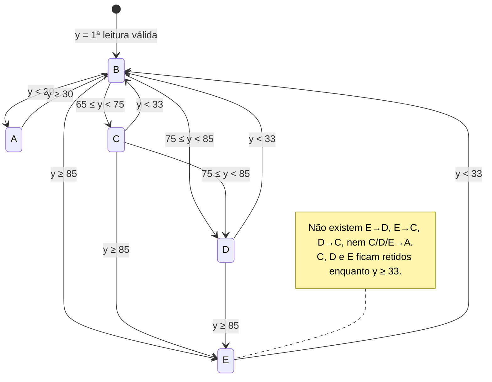

# Ensaios de bancada – Interface Cérebro-Máquina (sem participantes humanos)

Versão da lógica descrita aqui: **v2** (tag `v1.0-artigo`). A lógica anterior (v1) está preservada em
`ensaios/legado/` só para comparação. Os números de linha abaixo referem-se à v2.
Números que dependem de hardware estão marcados como **a medir**.

| Arquivo | Conteúdo |
|---|---|
| `logica_icm.py` | Lógica isolada: importa a `EEGStateMachine` atual (v2) e a v1 preservada, e define as lógicas de comparação |
| `legado/eeg_state_machine_v1.py` | Cópia literal de `src/services/eeg_state_machine.py` no commit `5fca7f5` (v1) |
| `ensaio1_sintetico.py` | Parte 1 – sinal sintético (roda sem hardware) |
| `ensaio2_latencia.py` | Parte 2 – latência PC ↔ Arduino (medida via USB; via HC-05 **a medir**) |
| `ensaio3_4_headset.py` | Parte 3 – qualidade de sinal e taxa de atualização do BrainLink (medido) |
| `resultados/` | CSV, tabelas Markdown e figuras do ensaio 1; CSV dos ensaios 2, 3 e 4 |

Testes automatizados da máquina de estados: `tests/test_eeg_state_machine.py` (`python -m pytest`,
100 testes).

### De onde veio cada trecho de lógica usado nos ensaios

| Trecho nos ensaios | Origem no repositório | Como |
|---|---|---|
| `MaquinaRealV2` | `src/services/eeg_state_machine.py` (classe inteira) | **importada**, sem cópia |
| `MaquinaRealV1` | `ensaios/legado/eeg_state_machine_v1.py` = mesmo arquivo no commit `5fca7f5` | **importada** da cópia literal |
| `pacote_para_comando` | `src/services/eeg_state_sytem.py`, `_on_eeg`, linhas 20-28 | reproduzida (descarta `attention == 0`, chama `processar`, envia) |
| `FiltroIniciado` | `eeg_state_machine.py`, linhas 11-12 e 51-59 (filtro da v2) | reproduzido; só é usado pelas lógicas de comparação, para que tenham o mesmo filtro da v2 |
| `V1SemBloqueado` | `legado/eeg_state_machine_v1.py`, linhas 16-60 | cópia sem as linhas de `bloqueado`; justifica a remoção (verificação 1) |
| `FaixasSemTrava`, `HistereseClassica` | — | **não existem no projeto**: são referências de comparação |
| Leitura do headset (ensaio 3) | `src/adapters/brainlink_adapter.py` + `eeg_state_sytem.py`, linhas 43-52 | `BrainlinkAdapter` e `BrainLinkParser` **importados**; o callback de leitura é reproduzido |
| Porta do HC-05 (ensaio 2) | `src/adapters/arduino_adapter.py`, linha 12 | mesmos parâmetros (9600 bps) |

---

## Parte 0 – Lógica real (v2, lida do código)

### 1. Valor de α e valor inicial de y

- **α = 0,50** (`eeg_state_machine.py:4`, `def __init__(self, alpha=0.50)`). `EEGSystem` instancia
  sem argumento (`eeg_state_sytem.py:15`).
- **y inicial = primeira leitura válida.** No primeiro pacote com atenção ≠ 0, y recebe a própria
  leitura, sem EMA (`eeg_state_machine.py:52-57`). Daí em diante:
  `y ← α·x + (1−α)·y_anterior` (`eeg_state_machine.py:12` e `:59`).
- Os pacotes com atenção 0 já são descartados antes da máquina (`eeg_state_sytem.py:20-21`). A
  própria máquina também ignora um 0 enquanto não foi inicializada (`eeg_state_machine.py:54-55`).

### 2. Envio a cada pacote ou só na mudança?

**A cada pacote** (sem mudança na v2). `_on_eeg` (`eeg_state_sytem.py:19-28`) chama
`self.arduino.enviar_estado(novo_estado.value)` sempre que `data.attention != 0`, sem comparar com o
estado anterior. Isso dá ≈ 60 comandos/min a 1 Hz. No firmware, repetir o mesmo caractere reescreve os
mesmos ângulos, sem movimento.

### 3. Qualidade de sinal (signal/poorSignal)

**Não é usada** (sem mudança na v2). O único campo lido do objeto do SDK é `data.attention`
(`eeg_state_sytem.py:20` e `:23`). O SDK expõe o atributo `signal` em `BrainLinkData` (README de
`github.com/Macrotellect/BrainLinkParser-Python`), mas o README não documenta a faixa nem o
significado desse campo. O único "portão" é `if data.attention == 0: return`. O ensaio 3 registra o
`signal` junto da atenção (**a medir**).

Observação lateral: o projeto abre o BrainLink a 57600 bps (`brainlink_adapter.py:11`). O exemplo do
README do SDK usa 115200. Em portas Bluetooth SPP a velocidade costuma ser ignorada, mas vale citar.

### 4. Lógica de estados e "trava"

A lógica é uma máquina de estados (`_transicao`, `eeg_state_machine.py:16-48`): o limiar depende do
estado atual, e cada pacote avalia só o `case` do estado corrente (no máximo 1 transição por pacote).
Não há variável de trava. A "trava" é a **histerese assimétrica**: C, D e E ficam retidos até y < 33
e então voltam para B.

**Pseudocódigo fiel** (estado inicial B):

```
a cada pacote x:
    se x == 0: ignorar pacote                         # eeg_state_sytem.py:20
    se o filtro não foi inicializado: y ← x           # eeg_state_machine.py:52-57
    senão: y ← 0,5·x + 0,5·y                          # linha 59
    conforme estado:                                  # linhas 16-48
      A: se y ≥ 30 → B
      B: se y < 20 → A
         senão se y ≥ 85 → E
         senão se y ≥ 75 → D
         senão se y ≥ 65 → C
      C: se y ≥ 85 → E
         senão se y ≥ 75 → D
         senão se y < 33 → B
      D: se y ≥ 85 → E
         senão se y < 33 → B
      E: se y < 33 → B
    enviar caractere do estado ao Arduino             # eeg_state_sytem.py:28
```



Consequências:

- **A "trava" vale para a faixa "até 20"?** Não. O A tem histerese própria (entra com y < 20, sai
  com y ≥ 30), e nada impede E→B→A em pacotes consecutivos. Isso não mudou da v1 para a v2.
- **Subida contínua 50→90:** com α = 0,5 (código), **D e E são alcançados em todas as velocidades
  testadas** (degrau, 10, 5, 2, 1 e 0,5 pt/s: sempre B→C→D→E). Com α = 0,1–0,3 também.
  A única exceção é o sinal **bruto em degrau** (50 → 90 num único pacote), que vai direto de B para
  E. Isso é esperado: o salto atravessa 75–85 sem nenhuma amostra intermediária. Tabela completa:
  `resultados/ensaio1_subida_50_90.md`.
- **Descida:** C e D continuam **não** sendo emitidos. E fica retido até y < 33 e então vai para B.
  Isso não mudou.
- **Partida:** com primeira leitura ≥ 20, a v2 não passa por A
  (`resultados/ensaio1_partida.md` e os testes `test_partida_sem_A_*`).

### 5. Limiares e mapeamento (v2)

| Transição | Limiar (sobre y filtrado) | Linha (`eeg_state_machine.py`) |
|---|---|---|
| B → A | y < 20 | 23 |
| A → B | y ≥ 30 | 19 |
| B → C | 65 ≤ y < 75 | 29 |
| B → D | 75 ≤ y < 85 | 27 |
| B → E | y ≥ 85 | 25 |
| C → D | 75 ≤ y < 85 | 35 |
| C → E | y ≥ 85 | 33 |
| D → E | y ≥ 85 | 41 |
| C, D, E → B | y < 33 | 37, 43, 47 |
| (início) | y ← 1ª leitura ≠ 0 | 52-57 |

Mapeamento estado → caractere → postura (`core/state_enum.py`; `firmware/icm_firmware.ino`; significado do README):

| Estado | Char | Significado (README) | Polegar | Indicador | Médio | Anelar | Mínimo |
|---|---|---|---|---|---|---|---|
| A | `A` | Distração | 180 | 180 | 0 | 0 | 0 |
| B | `B` | Neutro | 0 | 0 | 0 | 0 | 0 |
| C | `C` | Foco leve | 180 | 180 | 180 | 180 | 180 |
| D | `D` | Foco alto | 0 | 0 | 0 | 180 | 180 |
| E | `E` | Foco máximo | 0 | 0 | 180 | 180 | 0 |

Na v2, as subidas usam os mesmos limiares em qualquer estado (65/75/85). As descidas usam 33
(C/D/E → B) e 20/30 para o A.

---

## Mudanças entre v1 e v2

Commit das mudanças: `963f761`. A v1 é o commit `5fca7f5`.

| # | Mudança | Por quê |
|---|---|---|
| 1 | C → E passa de y ≥ 80 para **y ≥ 85**; C → D vale para 75 ≤ y < 85 | Na v1, a partir de C o gesto D só existia em [75, 80), e numa subida moderada era pulado |
| 2 | Removidas as variáveis `bloqueado` e `piso`, o "Bloqueado" do console e o sufixo "· bloqueado" da interface (e o campo `blocked` do `EEGBuffer`, que só alimentava esse sufixo) | Código morto: `bloqueado` nunca era lido numa decisão, e "piso ≤ D" / "piso ≤ E" eram sempre verdadeiras |
| 3 | Filtro inicia com a primeira leitura válida, e não com y = 0 | Com y = 0, a v1 passava por A na partida |

**Verificações de que nada mais mudou** (`ensaio1_sintetico.py`, sequências da repetição 0 de
todos os cenários e as subidas 50→90, com todos os α):
1. v1 × v1 sem `bloqueado`: **0 diferenças em 95 565 pacotes** (comando e valor filtrado).
2. v1 (com o início de filtro da v2) × v2, em paralelo: **4 divergências, todas no caso pretendido**
   (estado C com 80 ≤ y < 85: v1 → E, v2 → D) e **0 divergências por outro motivo, em 94 620 pacotes**.
3. Testes pytest: os 100 passam na v2. Rodando a mesma suíte contra a v1, 41 falham, todos ligados
   aos itens 1-3 da tabela.

**Efeito medido** (lógica real, α = 0,5 do código, salvo indicação; média ± DP de 30 repetições):

| Situação | v1 | v2 |
|---|---|---|
| Subida 50→90 a 10 pt/s, sem ruído | B→C→E (D pulado) | B→C→D→E |
| Subida 50→90 a 10 pt/s, sinal bruto | B→C→E (D pulado) | B→C→D→E |
| Rampa + σ = 5: repetições em que D foi alcançado | 97 % | 100 % |
| Rampa + σ = 10: repetições em que D foi alcançado | 87 % | 100 % |
| Rampa + σ = 5: espúrios/min | 0,34 ± 0,09 | 0,34 ± 0,09 |
| Rampa + σ = 10: espúrios/min | 0,90 ± 0,20 | 0,91 ± 0,20 |
| Oscilação no limiar 84/85, σ = 3 / 5 / 10: espúrios/min | 0,14 / 0,16 / 0,15 | 0,04 / 0,05 / 0,09 |
| Sinal constante 20 ou 25, sem ruído: segundos em A (de 60) | 60 | 0 |
| Sinal constante 70 / 92, sem ruído: primeiros comandos | `BBBC…` / `BCE…` | `CCC…` / `EEE…` |
| Patamar B (42) com ruído σ = 3 / 5 / 10: repetições com A nos primeiros 60 s | 30 % / 27 % / 43 % | 0 % / 0 % / 0 % |
| Patamar E (92,5), σ = 5: atraso médio | 2,57 ± 0,73 s | 0,10 ± 0,31 s |

Na rampa 0→100→0 as duas versões são praticamente iguais. A rampa começa em 0, então as duas
partem de A, e a subida lenta (0,33 pt/s) sempre amostra a faixa 75–80.

**Efeito colateral da v2 (medido, não corrigido).** A v2 inicia o filtro com **uma única** leitura.
Com ruído, essa leitura pode cair numa faixa acima da do sinal, e C/D/E ficam retidos até y < 33.
Nos patamares fixos (cenário d), isso aparece como entradas não atendidas:

| Patamar (cenário d), α = 0,5 | σ = 3 | σ = 5 | σ = 10 |
|---|---|---|---|
| C (69,5), v1 → v2 | 0 % → 13 % | 0 % → 17 % | 7 % → 13 % |
| D (79,5), v1 → v2 | 0 % → 3 % | 13 % → 27 % | 40 % → 40 % |

Exemplo: no patamar D com σ = 5, em parte das repetições a 1ª leitura foi ≥ 85, a mão foi direto
para E e lá ficou. Na v1 o filtro subia de 0 e atravessava a faixa D. É uma limitação a declarar no
artigo. Uma alternativa seria iniciar o filtro com a média das primeiras N leituras, mas **isso não
foi implementado nem medido**.

---

## Parte 1 – Ensaio com sinal sintético

```bash
python ensaios/ensaio1_sintetico.py
```

(≈ 45 s; precisa de numpy e matplotlib, já listados em `requirements.txt`; não precisa do SDK.)

**Método** (igual ao da primeira rodada). O sinal é gerado a 1 Hz por 600 s, com semente 20261105
e 30 repetições por cenário. O ruído é gaussiano, somado ao sinal limpo, arredondado para inteiro e
saturado em [0, 100]. Pacotes iguais a 0 são descartados, como no código. A mesma realização de
ruído alimenta todas as configurações (comparação pareada).

- (a) rampa 0→100→0 (300 s subindo, 300 s descendo), sem ruído;
- (b) a mesma rampa com σ = 3, 5 e 10;
- (c) senoide de amplitude ±5 e período 60 s (fase aleatória) centrada em 20, 64,5, 74,5 e 84,5, com σ = 3, 5 e 10;
- (d) patamar fixo em 10, 42, 69,5, 79,5 e 92,5 (centro de cada faixa nominal), com σ = 3, 5 e 10.

**Configurações (20).** Quatro lógicas × cinco filtros (bruto = α 1,0; α = 0,1, 0,2, 0,3 e 0,5, que é o do código):
- `real_v2`: a lógica atual do projeto (importada). **Principal.**
- `real_v1`: a lógica antiga (importada de `ensaios/legado/`), com y inicial = 0.
- `faixas_sem_trava`: faixa nominal 20/65/75/85 do valor filtrado, sem memória. É a lógica "sem trava".
- `histerese_3`: limiares nominais com histerese clássica: sobe com L+3, desce com L−3.

As duas lógicas de comparação usam **o mesmo filtro da v2** (início na primeira leitura válida).
Na primeira rodada elas usavam y₀ = 0, como a v1. Isso muda só o comportamento delas na partida.

**Métricas** (mesmas da primeira rodada; média ± desvio-padrão das 30 repetições):
- *Comandos/min*: caracteres enviados (todas as lógicas usam a política do código: um por pacote).
- *Trocas/min*: mudanças de gesto (seria a taxa de comandos se o envio fosse só na mudança).
- *Espúrios/min*: troca para o gesto G que não corresponde a uma entrada do sinal sem ruído
  (quantizado) na faixa nominal G. Cada entrada do sinal limpo em G legitima **uma** troca para G,
  desde o instante da entrada até 10 s depois que o sinal limpo sai de G. Uma troca **antecipada**
  (antes de o sinal limpo entrar na faixa) conta como espúria. Também é dada a mesma métrica só para
  t ≥ 60 s.
- *Atraso*: tempo entre o sinal limpo entrar na faixa G e o primeiro comando G (dentro da mesma
  janela). *Entradas não atendidas*: % das entradas do sinal limpo sem nenhum comando G nessa janela.
- *Gestos alcançados*: % das repetições em que cada gesto foi emitido ao menos uma vez.

### Tabela principal – rampa + ruído σ = 5 (cenário b)

| Lógica | Filtro | Comandos/min | Trocas/min | Espúrios/min | Espúrios/min (t ≥ 60 s) | Atraso médio (s) | Entradas não atendidas (%) | Gestos alcançados (% das rep.) |
|---|---|---|---|---|---|---|---|---|
| real_v2 | bruto | 58.70 ± 0.29 | 1.27 ± 0.31 | 0.97 ± 0.31 | 1.03 ± 0.34 | 12.60 ± 1.45 | 24 | A:100 B:100 C:100 D:100 E:100 |
| real_v2 | α=0.1 | 58.70 ± 0.29 | 0.70 ± 0.00 | 0.00 ± 0.00 | 0.00 ± 0.00 | 26.41 ± 1.27 | 22 | A:100 B:100 C:100 D:100 E:100 |
| real_v2 | α=0.2 | 58.70 ± 0.29 | 0.70 ± 0.00 | 0.07 ± 0.07 | 0.08 ± 0.08 | 20.51 ± 1.20 | 22 | A:100 B:100 C:100 D:100 E:100 |
| real_v2 | α=0.3 | 58.70 ± 0.29 | 0.70 ± 0.00 | 0.19 ± 0.10 | 0.21 ± 0.11 | 18.51 ± 0.77 | 22 | A:100 B:100 C:100 D:100 E:100 |
| real_v2 | α=0.5 (código) | 58.70 ± 0.29 | 0.71 ± 0.05 | 0.34 ± 0.09 | 0.37 ± 0.10 | 15.99 ± 1.20 | 22 | A:100 B:100 C:100 D:100 E:100 |
| real_v1 | bruto | 58.70 ± 0.29 | 1.26 ± 0.30 | 0.96 ± 0.31 | 1.02 ± 0.33 | 12.75 ± 1.66 | 25 | A:100 B:100 C:100 D:90 E:100 |
| real_v1 | α=0.1 | 58.70 ± 0.29 | 0.70 ± 0.00 | 0.00 ± 0.00 | 0.00 ± 0.00 | 26.41 ± 1.27 | 22 | A:100 B:100 C:100 D:100 E:100 |
| real_v1 | α=0.2 | 58.70 ± 0.29 | 0.70 ± 0.00 | 0.07 ± 0.07 | 0.08 ± 0.08 | 20.51 ± 1.20 | 22 | A:100 B:100 C:100 D:100 E:100 |
| real_v1 | α=0.3 | 58.70 ± 0.29 | 0.70 ± 0.00 | 0.19 ± 0.10 | 0.21 ± 0.11 | 18.51 ± 0.77 | 22 | A:100 B:100 C:100 D:100 E:100 |
| real_v1 | α=0.5 (código) | 58.70 ± 0.29 | 0.71 ± 0.05 | 0.34 ± 0.09 | 0.37 ± 0.10 | 16.09 ± 1.40 | 23 | A:100 B:100 C:100 D:97 E:100 |
| faixas_sem_trava | bruto | 58.70 ± 0.29 | 13.18 ± 0.95 | 12.28 ± 0.95 | 12.78 ± 0.97 | 0.91 ± 0.38 | 0 | A:100 B:100 C:100 D:100 E:100 |
| faixas_sem_trava | α=0.1 | 58.70 ± 0.29 | 1.27 ± 0.30 | 0.38 ± 0.30 | 0.42 ± 0.33 | 7.88 ± 1.19 | 0 | A:100 B:100 C:100 D:100 E:100 |
| faixas_sem_trava | α=0.2 | 58.70 ± 0.29 | 2.28 ± 0.47 | 1.40 ± 0.45 | 1.54 ± 0.49 | 2.87 ± 0.81 | 0 | A:100 B:100 C:100 D:100 E:100 |
| faixas_sem_trava | α=0.3 | 58.70 ± 0.29 | 3.28 ± 0.65 | 2.39 ± 0.65 | 2.54 ± 0.71 | 1.89 ± 0.68 | 0 | A:100 B:100 C:100 D:100 E:100 |
| faixas_sem_trava | α=0.5 (código) | 58.70 ± 0.29 | 5.63 ± 0.71 | 4.74 ± 0.70 | 4.99 ± 0.74 | 1.33 ± 0.56 | 0 | A:100 B:100 C:100 D:100 E:100 |
| histerese_3 | bruto | 58.70 ± 0.29 | 5.82 ± 0.69 | 4.93 ± 0.68 | 5.16 ± 0.71 | 1.40 ± 0.49 | 0 | A:100 B:100 C:100 D:100 E:100 |
| histerese_3 | α=0.1 | 58.70 ± 0.29 | 0.90 ± 0.00 | 0.00 ± 0.00 | 0.00 ± 0.00 | 15.73 ± 1.18 | 0 | A:100 B:100 C:100 D:100 E:100 |
| histerese_3 | α=0.2 | 58.70 ± 0.29 | 0.90 ± 0.00 | 0.01 ± 0.03 | 0.01 ± 0.03 | 9.95 ± 1.64 | 0 | A:100 B:100 C:100 D:100 E:100 |
| histerese_3 | α=0.3 | 58.70 ± 0.29 | 0.95 ± 0.09 | 0.10 ± 0.14 | 0.10 ± 0.16 | 6.87 ± 1.27 | 0 | A:100 B:100 C:100 D:100 E:100 |
| histerese_3 | α=0.5 (código) | 58.70 ± 0.29 | 1.43 ± 0.26 | 0.60 ± 0.27 | 0.62 ± 0.30 | 3.40 ± 1.05 | 0 | A:100 B:100 C:100 D:100 E:100 |

O sinal ideal (rampa limpa) tem 0,9 trocas/min (A→B→C→D→E→D→C→B→A).

### Rampa sem ruído (cenário a) – real_v2

| Filtro | Gestos alcançados | Atraso A / B / C / D / E (s) | Entradas não atendidas |
|---|---|---|---|
| bruto | A B C D E (100 %) | 1,0 / 63,0 / 0 / 0 / 0 | 22 % (C e D na descida) |
| α = 0,1 | A B C D E (100 %) | 4,5 / 71,5 / 10 / 10 / 10 | 22 % |
| α = 0,2 | A B C D E (100 %) | 2,5 / 67,5 / 6 / 6 / 6 | 22 % |
| α = 0,3 | A B C D E (100 %) | 1,5 / 65,5 / 4 / 4 / 4 | 22 % |
| α = 0,5 (código) | A B C D E (100 %) | 1,0 / 64,5 / 3 / 3 / 3 | 22 % |

Esses valores são idênticos aos da v1 neste cenário. Na descida, a v2 não emite D nem C. O atraso de
B (~64 s com α = 0,5) é o tempo que o sinal leva para descer de 64 até 33 a 0,33 pt/s. Não é
latência de processamento: é consequência da retenção de C/D/E até y < 33.

### Partida (real_v2, sinal constante sem ruído)

| Sinal constante | Primeiros 15 comandos, α = 0,5 | Segundos em A (de 60), qualquer α testado |
|---|---|---|
| 19 | `AAAAAAAAAAAAAAA` | 60 (correto: está na faixa A) |
| 20 | `BBBBBBBBBBBBBBB` | 0 |
| 25 | `BBBBBBBBBBBBBBB` | 0 |
| 42 | `BBBBBBBBBBBBBBB` | 0 |
| 70 | `CCCCCCCCCCCCCCC` | 0 |
| 92 | `EEEEEEEEEEEEEEE` | 0 |

Tabela completa (v1 e v2, os cinco filtros e o cenário d com ruído): `resultados/ensaio1_partida.md`.

### Principais observações (todas do ensaio sintético, lógica real_v2)

1. **Comandos/min ≈ 57–60 em todas as configurações**, porque o código envia a cada pacote.
   A taxa só cai quando o ruído gera pacotes iguais a 0, que são descartados: 49,7/min no patamar
   em 10 com σ = 10. As trocas de gesto efetivas ficam em 0,70–0,71/min na rampa com σ ≤ 5, contra
   0,9/min do sinal ideal (C e D não aparecem na descida).
2. **Ruído vs. filtro.** Com σ = 5 e α = 0,5, a real_v2 tem 0,34 ± 0,09 espúrios/min.
   Sem memória (`faixas_sem_trava`) são 4,74 ± 0,70, e com histerese de ±3 são 0,60 ± 0,27.
   Com σ = 10: 0,91 ± 0,20 (real_v2), 10,13 ± 1,02 (sem trava) e 4,44 ± 0,58 (histerese ±3).
   Ver `resultados/fig3_espurios.png`.
3. **Natureza dos espúrios.** Na rampa com α = 0,5, a maioria dos espúrios da real_v2 são
   **antecipações**: a troca para G ocorre até 15 s antes de o sinal limpo entrar em G. São 70 de 71
   com σ = 3, 87 de 101 com σ = 5 e 61 de 274 com σ = 10 (30 repetições), com mediana de 4, 7 e
   10 s (`resultados/ensaio1_antecipacoes.md`).
4. **Custo da retenção.** A real_v2 tem o maior atraso médio, e 22 % das entradas de faixa na rampa
   nunca são atendidas (C e D na descida). A histerese ±3 com α = 0,2 obteve espúrios equivalentes
   (0,01 ± 0,03/min com σ = 5) com 0 % de entradas não atendidas e atraso de 9,95 ± 1,64 s.
5. **Limiar 20 (cenário c).** É o ponto mais sensível. Com σ = 10 e α = 0,5 há 2,28 ± 0,42
   espúrios/min e 3,84 ± 0,50 trocas/min (`resultados/ensaio1_resumo.md`).
6. **D na subida.** Com a v2, D foi alcançado em 100 % das repetições da rampa com ruído
   (σ = 3, 5 e 10, α = 0,5), contra 97 % e 87 % da v1 com σ = 5 e 10.

Tabelas completas (a, b para cada σ, c para cada limiar e σ, d para cada faixa e σ, atraso por gesto,
as duas verificações): `resultados/ensaio1_resumo.md`. Dados brutos por repetição:
`resultados/ensaio1.csv` (18 600 linhas; colunas `cenario, sigma, alvo, logica, alpha, filtro, rep,
cmd_min, trocas_min, espurios_min, espurios_regime_min, atraso_s, entradas, entradas_nao_atendidas,
gestos_emitidos, alcancou_A..E, atraso_A_s..atraso_E_s`).

Figuras (lógica real_v2):
- `resultados/fig1_serie_temporal.png`: rampa + σ = 5, bruto, filtrado (α = 0,5), sinal limpo,
  limiares nominais (linha cheia) e extras da máquina real (30 e 33, pontilhados), com o gesto
  enviado embaixo;
- `resultados/fig2_rampa_limpa.png`: o mesmo, sem ruído (mostra a retenção de E na descida);
- `resultados/fig3_espurios.png`: espúrios/min das 20 configurações, σ = 3, 5 e 10.

Limitações: o sinal sintético não reproduz a dinâmica real do eSense (autocorrelação, saturações,
valores 0 por mau contato). Os números acima caracterizam a **lógica de decisão**, não o desempenho
com usuários. A definição de "espúrio" é uma escolha deste ensaio (descrita acima e no cabeçalho do
script). Antecipações contam como espúrias.

---

## Parte 2 – Latência (USB medido; HC-05 a medir)

**Firmware.** Foi adicionado em `firmware/icm_firmware.ino`, dentro do `switch`, antes do `default`:

```cpp
case 'T':
  // Ensaio de latência (ensaios/ensaio2_latencia.py): eco sem mover servos
  Serial.write('T');
  break;
```

Os casos A–E não mudaram. O software da ICM nunca envia 'T'.

**Como rodar:**
1. Grave o firmware atualizado (desconecte o HC-05 dos pinos 0/1 durante o upload, como no README).
2. Feche o programa principal (a porta do HC-05 só pode ser aberta por um processo).
3. Rode o ensaio:

```bash
python ensaios/ensaio2_latencia.py --porta COM5
```

Opções: `--n 200` (envios), `--timeout 1.0` (s), `--intervalo 0.1` (s entre envios),
`--espera-inicial 2.0` (s após abrir a porta) e `--saida arquivo.csv`. Para testar o script sem
hardware: `--porta loop://` (eco do próprio pyserial).

**Saída:** `ensaios/resultados/ensaio2_<data>.csv` (`i, t_envio_s, rtt_ms, resposta, perdida`). No
terminal: RTT médio, desvio-padrão, mínimo, máximo, mediana e % de respostas perdidas (timeout 1 s).

**Medido em 04/11/2026 pelo cabo USB (COM7, Arduino Uno com conversor CH340), não pelo HC-05.**
O HC-05 (COM8) não conectou nesse dia (o Windows deu "tempo limite do semáforo expirou" ao abrir a
porta) e foi desconectado dos pinos 0/1 para a gravação do firmware com o `case 'T'` (via
`arduino-cli`, placa `arduino:avr:uno`). Os números abaixo são, portanto, um **piso**: PC → USB-serial →
laço do Arduino → volta, sem o enlace Bluetooth SPP. A latência com o HC-05 continua **a medir**.

3 rodadas × 200 envios, timeout 1 s, 0,1 s entre envios, 3 s de espera após abrir a porta
(`resultados/latencia_1.csv`, `latencia_2.csv`, `latencia_3.csv`):

| Métrica | Rodada 1 | Rodada 2 | Rodada 3 | Total (600 envios) |
|---|---|---|---|---|
| RTT médio ± DP (ms) | 4,05 ± 0,19 | 4,02 ± 0,21 | 3,98 ± 0,28 | 4,02 ± 0,23 |
| Mediana (ms) | 4,08 | 4,04 | 3,94 | 4,02 |
| Mínimo / máximo (ms) | 3,63 / 4,42 | 3,59 / 4,48 | 3,61 / 6,77 | 3,59 / 6,77 |
| Respostas perdidas (%) | 0 | 0 | 0 | 0 |

| Métrica (via HC-05, Bluetooth) | Valor |
|---|---|
| RTT médio ± DP (ms) | a medir |
| Mínimo / máximo (ms) | a medir |
| Respostas perdidas (%) | a medir |

A 9600 bps, cada byte (8N1) leva ≈ 1,04 ms na linha. Ida e volta somam ≈ 2,1 ms; o restante (~2 ms)
vem do conversor USB e do sistema operacional.

O RTT inclui os dois sentidos do enlace Bluetooth SPP, os buffers do sistema operacional e o laço do
Arduino. Usar RTT/2 como latência de ida é uma aproximação (o enlace pode ser assimétrico).

---

## Parte 3 – Qualidade de sinal e taxa de atualização (medido)

Requer o SDK em `deps/` (como no README do projeto; Windows + Python 3.11). Feche o programa
principal antes. **Nada é enviado ao Arduino.**

```bash
python ensaios/ensaio3_4_headset.py --porta COM7 --modo fora_da_cabeca
```

```bash
python ensaios/ensaio3_4_headset.py --porta COM7 --modo em_uso
```

- `fora_da_cabeca`: 2 min (headset ligado, sobre a mesa); `em_uso`: 5 min. `--duracao S` sobrescreve.
- **Saída:** `ensaios/resultados/ensaio3_4_<modo>_<data>.csv`, uma linha por pacote EEG:
  `t_unix, t_rel_s, attention, meditation, signal, att_filtrada, comando`. `comando` vazio significa
  atenção 0, que o sistema descarta.
- **No terminal, ao final:** intervalo médio entre pacotes de atenção (DP, mín., máx. e taxa em Hz),
  intervalo entre pacotes não nulos, % de pacotes com atenção 0, distribuição dos valores de `signal`,
  e quantas vezes o gesto A teria sido disparado (entradas em A e nº de pacotes com 'A').

Medido em 04/11/2026 com o BrainLink SE na COM5 (Bluetooth SPP), um único usuário, sem tarefa
cognitiva definida. `em_uso` começou 30 s depois de o headset ser colocado.
CSV: `resultados/ensaio3_4_fora_da_cabeca_20261104_221304.csv` e
`resultados/ensaio3_4_em_uso_20261104_221657.csv`.

| Métrica | fora_da_cabeca (120 s) | em_uso (300 s) |
|---|---|---|
| Pacotes EEG recebidos | 121 | 301 |
| Intervalo médio entre pacotes (s) | 0,995 (DP 0,028; 0,895–1,064) | 0,995 (DP 0,076; 0,317–1,691) |
| Taxa de atualização (Hz) | 1,005 | 1,005 |
| Pacotes com atenção 0 (%) | 100 | 0 |
| Valores de `signal` observados | 200 (121 pacotes) | 0 (298), 25 (2), 51 (1) |
| Atenção bruta: média ± DP (mín.–máx.) | 0 | 64,8 ± 20,8 (3–100) |
| Comandos que seriam enviados | 0 | 301 |
| Disparos do gesto A | 0 | 3 entradas em A (12 pacotes com 'A') |

Observações:
- **Fora da cabeça o portão `attention == 0` funciona:** todos os pacotes têm atenção 0 e o sistema
  não enviaria nada, e o gesto A nunca seria disparado. O `signal` fica fixo em 200, que no protocolo
  ThinkGear da NeuroSky corresponde a "sem contato" (o README do SDK não documenta a faixa).
- **Em uso**, `signal` = 0 (contato bom) em 99 % dos pacotes. Os 3 pacotes com `signal` > 0 ocorreram
  juntos, em t ≈ 38–40 s, e a atenção seguiu válida (47). Como o sistema não lê `signal`, esses pacotes
  geraram comando normalmente.
- Distribuição dos comandos em uso: E 149, D 64, C 46, B 30, A 12. Foram 20 trocas de gesto em 5 min
  (4,0 trocas/min). As 3 entradas em A ocorreram no fim da gravação, em t = 236, 244 e 287 s. Duas
  vieram direto de um gesto alto em pacotes consecutivos (D→B→A e E→B→A), como previsto na Parte 0,
  item 4. A outra veio de B.
- A taxa de 1 Hz confirma a premissa do ensaio 1 (sinal gerado a 1 Hz).

Correção feita para rodar: o script importava `MaquinaReal`, nome que deixou de existir em
`logica_icm.py` na v2 (agora `MaquinaRealV2`). O import foi corrigido e o ensaio usa a lógica v2. Ao
redirecionar a saída para arquivo, use `python -u`. Sem essa opção, o resumo final pode se perder,
porque o `os._exit` encerra o processo antes de esvaziar o buffer.
